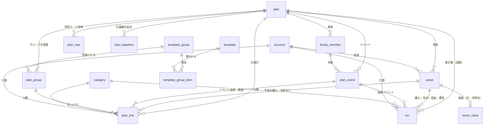

# 家計簿兼ライフプランアプリ 設計書

最終更新：2026-11-20　／　画面：[wireframes/](wireframes/)（一覧は wireframes/index.html、画像は wireframes/screenshots/）

## 1. 概要

日々の家計簿（実績）と、家族構成に沿った将来の資金計画（ライフプラン）を1つのスマホアプリで管理する。家族の複数端末で全データを共有し、自宅Wi-Fi内の同期ボタンでマージする。

### 1.1 前提

| 項目 | 内容 |
| --- | --- |
| 対象OS | Android（最低 Android 8 / API 26）。iOS は今回の対象外（後回し） |
| 開発技術 | Flutter |
| 端末内DB | SQLite（drift） |
| 同期サーバ | 自宅サーバの Redis（自宅Wi-Fi内からのみ接続） |
| 通貨 | 日本円のみ |
| 利用者 | 家族（全データを共有、非公開データなし） |
| 起動ロック | なし |

### 1.2 参考アプリ（shin-lifeplan-app）からの見直し点

| 参考アプリの問題 | 本アプリでの対応 |
| --- | --- |
| 取引が年ごとの入れ子で、`year` を親子で二重に保持 | 取引を1テーブルに平置きし、日付列で検索・集計する |
| 日付が年・月のみ | 実績は日付（YYYY-MM-DD）単位 |
| 実績と計画が同じ取引データに混在 | 実績（transaction）と計画（plan_line）を別テーブルに分離 |
| 保有資産が数量固定＋購入年/売却年 | 保有数は売買履歴から導出。価格は日または月単位で記録 |
| テンプレートの項目が親子で重複 | テンプレート＝1回分の中身、グループ＝項目の集合（期間はプランへの登録時に決める）と役割を分離 |
| イベント→取引をIDリストで保持し参照切れが起きる | 子（計画行）側が親（イベント）IDを持つ一方向参照にする |
| 全データを1つのJSONで localStorage に保存 | SQLite のテーブルに正規化し、同期・書き出し時だけJSON化する |

## 2. 用語定義

| 用語 | 意味 |
| --- | --- |
| 実績 | 実際に発生したお金の動き。日付単位。プランごとに持つ（家計簿はプランごとに別） |
| 計画 | ライフプラン内の将来のお金の動き。年単位で立て、月ごとの明細行を持つ。予算も兼ねる |
| プラン（ライフプラン） | 家族・計画・イベント・利回り・インフレ率をまとめた1つのシナリオ。複数作成・複製できる |
| 表示プラン | ホームのライフプラン一覧で最後に開いたプラン。家計簿・資産・イベント・予実の比較はこのプランのものを表示する。切り替えはホームでプランを選ぶ（開く）か、家計簿・資産・イベントの画面上部のプラン名を押して行い、端末ごとに記憶する（同期しない） |
| 主人公 | プランごとに1人選ぶ家族メンバー。プラン期間の終了とグラフの年齢軸の基準 |
| 家族メンバー | プランに属する人物。全員に生年月日と寿命を持つ。プランごとに完全に別 |
| 口座 | 現金・銀行・証券などお金の置き場所。口座の定義は全プラン共通で、残高はプランごとの実績から計算する |
| 資産 | プランごとに持つ財産。株式・投資信託・不動産・車・持ち物など。評価は「数量×単価」か「評価額」を、日または月単位で指定して行う |
| テンプレート | 取引1回分の中身（種類・金額・カテゴリ・口座等）。単体では実績入力の雛形 |
| テンプレートグループ | 収入・支出の項目（テンプレート）の集合。給与明細も「給与＋税・社会保険料」のグループとして表す。項目ごとに頻度と金額（固定額か、他の項目の○%）を持つ。実績の一括入力にも使う。期間は持たず、プランに登録するときに開始年月・終了年月を決めて計画行を作る |
| イベント | 結婚・出産・住宅購入など。プランごとに持ち、対象家族・予定の時期・予定の収支（支出・収入・振替・資産の購入／売却）を持つ。実施したら実績を入力し、予定と実績を比べられる |
| 利確 | 資産の売却（売却画面）。専用画面で売却額（収入）・実現損益・税金や手数料（支出）をまとめて記録する |

## 3. 機能要件

### 3.1 家計簿（実績）

- 家計簿（実績）はプランごとに持つ。表示中のプランの家計簿を表示・入力し、ほかのプランの家計簿には影響しない
- 実績の種類は「収入・支出・振替」の3種。1件は日付・金額・カテゴリ・口座・メモを持つ。資産の購入は支出、売却は収入として記録し、資産を参照する（3.3）
- 収支カテゴリは1階層（収入用・支出用）。クレジットカードは区別せず、使った日に口座から支出として記録する
- 税金（資産の売却益・配当の税、給与の税など）と、資産の売買にかかる手数料などの費用は支出として記録する
- 家計簿は「実績」「予定」「比較」の3つの表示を画面上部で切り替える。どの表示も年単位と月単位（年・年月を前後に切替）を持ち、表示ごとに中身を混ぜない（上部の合計も、実績表示は実績だけ、予定表示は予定だけを出す）
  - 実績：上部にその年（月）の実績の収入・支出・収支。その下に実績のカテゴリ別の円グラフ（支出／収入を切替）と、カテゴリ別の内訳（金額・構成比）のアコーディオン。年表示では開いたときの表示を「月ごとにまとめる」（月を選ぶとその月の月表示へ）か「明細を1件ずつ」から選び、月表示ではその月の実績を1件ずつ出す。補助としてリスト（月別。カテゴリ・口座・種類・期間・金額範囲で絞り込み）とカレンダー（日ごとの収支）がある
  - 予定：表示プランの計画行だけで、実績と同じ構成（上部の合計・円グラフ・カテゴリ別の内訳・アコーディオン）を出す。補助としてリスト（月単位。由来＝グループ・手入力・イベントごとにまとめる）がある。予定は月単位なのでカレンダーはない
  - 比較：上部に予定・実績・差（実績−予定）の表。年表示は1月〜12月の全月を対象にし、実績がない月も出す（実績は¥0として数え、表では「—」）。年表示は月ごとの予定と実績の棒グラフも出す。続けて、総資産の計画・実績・差（年表示はその年末、月表示はその月末）と資産の予実へのリンク、両方で実績が未入力の予定の件数と金額（「予定から入力」へ）を出す（旧「予実サマリー」の内容をここに統合）。カテゴリ1つを1カードにして、予定と実績を横棒・金額・ウェイトで並べ、超過・余りを示す（並び順の既定は超過が大きい順）。年表示では、カードを開いたときの表示を「月ごと」（月別の予定・実績・差。月を選ぶとその月の比較へ）か「明細」から選ぶ。明細は予定と実績を分けて出し、「全て／実績／予定」で表示するものを切り替える。月表示でカードを開くと、その月の予定と実績の明細を同じ切り替えつきで出す
- 家計簿では予定も実績も入力できる。入力画面の「実績／予定」で切り替える（予定の表示から開くと予定が選ばれた状態）。予定は表示プランの手入力の計画行（`source=manual`）として、年月・種類・金額・カテゴリ・口座・イベント（任意）・メモを入れる。予定・実績の明細はどちらも押すと編集できる
- 収入・支出には、実績・予定とも資産を紐づけられる（資産（任意）を選ぶと「資産の動き」を選ぶ：支出は購入／費用、収入は売却／収益。数量×単価の資産の購入・売却は数量も入れる）。資産を指す予定・実績は、家計簿の入力画面と、資産タブ・資産詳細の購入・売却・収益・費用の画面のどちらからでも入力・編集できる
- 予定・実績はどちらも登録・編集・削除できる。グループやイベント由来の予定を編集すると、その行は手で編集した行になる（由来は保つ）
- 家計簿・資産・イベントの画面上部に表示中のプラン名を出し、押すと表示するプランを選び直せる
- 単体テンプレートを選ぶと入力画面に中身が入り、日付を決めて保存できる。グループを選ぶと、その項目をまとめて実績として入力できる（給与明細の入力など。3.2）
- 口座残高は初期残高＋実績から計算する。残高調整機能は持たない
  - 未来日付の実績も登録できる。残高はその日付で増減し、アプリは「現在」で実績を区別しない
  - 初期カテゴリは、支出：食費・消耗品・耐久消耗品・交際費・住居費・水道光熱費・通信費・保険・税金・その他、収入：利子所得・配当所得・不動産所得・事業所得・給与所得・退職所得・山林所得・譲渡所得・一時所得・雑所得。色は10色のパレットを順に割り当てる（後から選び直せる）。資産のカテゴリは「株式・投資信託」（数量×単価・売却時に税の初期値を出す）「不動産」「車・持ち物」（どちらも評価額）を用意する。固定カテゴリ（削除できないカテゴリ）は持たない。ほかのカテゴリは使う人が作る

### 3.2 テンプレートとグループ

- テンプレートは取引1回分の中身のみを持つ。種類は収入・支出・振替。資産を参照すると、資産の購入（支出）・売却（収入）・収益（収入）・費用（支出）の雛形になる。単体では実績入力の雛形になる。収入・支出のテンプレートは金額の上昇のしかた（カテゴリの率に従う／このテンプレートの年率／上昇なし）を持ち、プランに登録して予定を作るとき、収入・支出の金額を年ごとに増やす（6.3）
- グループは収入・支出の項目（テンプレート）の集合。給与も特別扱いせず、「給与（収入）＋所得税・住民税・社会保険料（支出）」のグループとして表す。ボーナスは「年1回・6月」のような頻度の項目にする
- 項目ごとに頻度を持つ：毎月／毎年（月指定）／Nか月ごと／N年ごと／毎週（曜日指定。月の回数を数える）／特定の月のみ。Nか月ごと・N年ごとは登録の開始年月を起点に数える
- 項目の金額は「固定額」か「同じグループの別の項目の○%」を選べる（例：所得税＝給与の5%）。割合の項目は、基準の項目が発生する月に、その月の基準額×%で発生する。基準にできるのは固定額の項目だけ（割合の連鎖はしない）
- グループの使い道は2つ：①ライフプランに登録して将来の計画行を作る（3.4）、②実績をまとめて入力する
- 実績の一括入力：グループを選び、日付と、各項目の実際の金額を入力して保存する。実績は実数値なので、グループの金額や割合からの計算値は目安として表示するだけで、実績にはしない。金額を入力した項目だけが実績になる（チェックボックスは持たない）。会社ごとに違う給与明細は、その会社用のグループを作って吸収する（手当や持株会などは項目を足す）
- 一括入力の内容でグループの金額・割合を更新できる。割合は、そのグループの直近12か月の一括入力の実績から提案できる（項目の合計÷基準項目の合計）
- グループ自体は期間を持たない。プランに登録するときに開始年月・終了年月を決める
- グループから実績を自動では作らない。実績はすべて手入力（一括入力を含む）
- 1つのテンプレートは複数のグループで使える
- テンプレートとグループはライフプランとは別管理で、全プランで共通に使える
- 資産を参照するテンプレートと、それを項目に含むグループは、その資産を持つプランでだけ使える。ほかのプランへの登録や、ほかのプランでの実績入力には使えない
- テンプレートは、グループで使われていても削除できる。削除するときは、テンプレート画面で「このテンプレートを使っているグループ」を示す警告を出し、各グループ名からグループ編集へ移れる（先に項目を差し替えられる）。作成済みの予定・実績は消えない
- 削除されたテンプレートを含むグループは、その項目が欠けた状態になる。グループ編集では欠けた項目を警告し、その場で項目を外すか別のテンプレートを選び直せる。そのグループをプランに登録するときと、グループから実績を入力するときは、欠けている項目を示す確認を出す。確認からグループの修正画面へ移るか、了承して残りの項目で登録・入力する。警告や確認には、内容を示すだけでなく、直すための画面へのリンクを必ず置く。欠けた項目を基準にした割合の項目も、金額を決められないので作らない
- グループを削除しても、そのグループで作った予定（計画行）と実績は残る。プランへの登録も残り、登録済みグループの画面で「元のグループは削除済み」と表示する。「指定年月以降の作り直し」はできなくなるが、「年範囲を指定して削除」「登録の取り消し」は使える

### 3.3 資産

- 資産はプランごとに持つ。株式・投資信託・不動産・車・持ち物など何でも登録でき、資産のカテゴリ（全プラン共通。自分で作成・編集できる）で分類する。資産一覧はカテゴリごとにまとめて表示する。外貨・NISA等の口座区分は扱わない
- 評価のしかたは資産ごとに選ぶ：「数量×単価」（株式・投資信託など。保有数は購入・売却の数量から導出）か「評価額」（不動産・車・持ち物など。資産全体の価値を直接指定）
- 価値（単価または評価額）は日単位（その日の価値）か月単位（その月の価値）で、何件でも指定できる。指定のない日・月は、それより前に指定した直近の価値が続く（6.2）。減価の自動計算はせず、値下がりも手入力で指定する
- 資産の購入は支出、売却は収入として記録し、どちらも資産を参照する（資産の動き：購入・売却）。カテゴリに初期値は持たず、入力のたびに選ぶ（固定カテゴリは持たない）。購入・売却の金額は家計簿の支出・収入・予実に含める。総資産では、購入した時点で現金が資産の評価額に置き換わる
- 資産からの収益（配当・家賃など）は収入、資産にかかる費用（売却益の税・手数料・固定資産税・登録費用など）は支出として、資産を参照して記録する（資産の動き：収益・費用）。購入・売却の画面では費用を何行でも一緒に入れられ、費用は元の購入・売却を指す
- 購入：数量×単価の資産は金額か数量のどちらかを入力し、もう一方は購入日時点の単価から計算する。評価額の資産は購入額を入れ、購入日の評価額として価値にも記録する（変更可）。後から価値を指定しても、作成済みの購入は再計算しない
- 売却：数量×単価の資産は数量を、評価額の資産は全部の売却として売却額を入れる。実現損益を自動表示する。カテゴリで「売却時に税の初期値を出す」とした資産は税額（利益×20.315%）を初期値として提示し修正可。それ以外の資産は税の初期値を出さず、必要なら費用として入れる
- 資産を登録しても、グループやテンプレートは自動では作らない。将来の積立・取崩し・配当などは、資産詳細から予定を登録するか、その資産を参照するテンプレート・グループを自分で作ってプランに登録する
- 資産の購入・売却・収益・費用の実績と予定は、任意で同じプランのイベントを参照できる（例：住宅購入イベント⇔自宅の購入）
- 配当などの収益（収入）と、税金・ローンの返済・維持費などの費用（支出）は、イベントと同じように資産に紐づける（txn / plan_line の asset_id と asset_action=income / cost）。配当は保有数に連動させず、資産ごとに金額を入れる。資産詳細から収益・費用の実績と予定を登録でき、グループ・テンプレートからも登録できる
- 資産詳細では、評価額の推移（実績線と計画線）をグラフで表示し、保有数・取得価額・評価額・含み損益、資産全体でどれだけ利益・損失が出たか（通算の損益。6.2）、価値の一覧、売買・収益・費用の一覧、関連するイベントを見られる
- 資産は1件ずつ・リストでJSONに書き出し・取り込みできる。資産単位のファイルには、価値と、その資産を参照する実績・予定、それらが参照するイベントも入る（3.9）

### 3.4 ライフプラン（計画）

- プランは複数作成でき、家族・計画行・イベント・利回り・上昇率・グループの登録・家計簿（実績）・資産を丸ごと複製できる。新しく作るときは、実績と資産を引き継ぐプランを選べる（選ばなければ空から始める）。どのプランも削除でき、配下のデータも一緒に削除する
- 複製（または実績と資産の引き継ぎ）では、複製元の資産を参照するテンプレートと、それを項目に含むグループも、複製先の資産を指すように複製する（名前に「(複製先のプラン名)」を付ける）。複製先のグループの登録（plan_group）は複製したグループを指す
- 実績と資産を引き継いで作るときは、実績と資産（価値と、その資産を参照するテンプレート・グループの複製を含む）だけを写し、家族・計画行・イベントは写さない（実績のイベントとの関連は外す）。最後の1つのプランは削除できない（2026-11-22 実装時に決定）
- 家族メンバーはプランごとに完全に別。全員が生年月日と寿命を持つ
- プラン期間は任意の開始年から、主人公の寿命の年まで
- 計画は年単位で立て、明細行（種類・年・月・カテゴリ・口座・金額・メモ）を複数持つ。種類は収入・支出・振替（資産の購入・売却などは資産を参照する）。月ごとの明細がそのまま予算になる
- 計画行の作り方：手入力／グループの登録／イベント
- グループの登録：グループと開始年月・終了年月を選ぶと、項目ごとの頻度で計画行を作る。登録していない期間は、その収入・支出がないものとして扱う
- 固定額の収入・支出は、上昇率（テンプレートに率があればその率、なければカテゴリ別の上昇率）で年ごとに増やした金額を保存する（基準は登録の開始年。将来開始のグループは、その年の金額で入力する）。給与カテゴリの上昇率が昇給率になる。振替と資産の購入・売却は増やさない。割合の項目は増えた基準額に連動する
- 昇給の鈍化・役職定年・再雇用・転職は、年の範囲を分けて別のグループを登録して表す
- 作った行は、グループを後で変えても自動では変わらない。登録ごとに「指定年月以降を今のグループの内容で作り直す」「年範囲を指定して削除する」「登録を取り消す（計画行ごと削除）」ができる
- イベントは対象家族・予定の年月・予定の収支を持ち、予定の収支は計画行として保存する（管理は3.10）
- 想定利回りはプラン×口座・資産ごと、上昇率（インフレ率・昇給率）はプラン×カテゴリごとに持つ
- ローンは残高を持たず、借入も記録しない（ローン口座・借入の振替は作らない）。返済はグループの支出項目として扱う。ローンで買う資産は、資産の購入を自己資金で払った額（頭金など）で記録し、評価額は価値で別に指定する

### 3.5 給与の扱い

- 給与は管理上ただの収入と支出。給与（額面）を収入、所得税・住民税・社会保険料をそれぞれ支出として持つ。制度どおりの税計算・料率表・給与専用の設定は持たない
- 実績：会社ごとの給与明細グループから一括入力する。額面と各支出を明細どおりに直して保存する
- 予測：同じグループをプランに登録する。税・社会保険料は「給与の○%」の割合項目にしておくと、昇給（給与カテゴリの上昇率）に連動する。割合は実績から提案できる
- ボーナスは別の項目（例：特定の月のみ・6月と12月）にし、その税・社会保険料はボーナスを基準にした割合項目にする
- 実績のない転職先などは、額面と割合を手入力したグループを作って登録する

### 3.6 シミュレーション

- 総資産は「計画線」（プランの起点残高＋計画行＋想定利回り）と「実績線」（実績と価格から計算した月末の資産。利回りは入れない）で計算する
- ライフプラン全体（ホームのカード・プラン詳細）では計画線の総資産だけを出し、実績は出さない。「現在の総資産」という考え方は持たない
- 計画と実績の総資産は、年ごと（年末）・月ごと（月末）に比べる画面（家計簿の比較・資産の予実）でだけ並べる
- プラン詳細の資産推移グラフは計画線だけで、「年単位」（生涯の年末ごと）と「月単位」（年を選び1月〜12月の月末ごと）を切り替える
- 現金が不足してもマイナスのまま表示し、警告を出す（自動取崩しはしない）

### 3.7 同期・データ管理

- 自宅Wi-Fi内で同期ボタンを押すと、キャッシュから取り込み・マージ・自端末の全データ書き込みを続けて行う
- 全データのファイル書き出し・復元（復元は端末のデータを全部消して上書きする。その後の同期では他端末のデータが通常どおりマージされる）、実績のCSV書き出し、参考アプリのJSONからの移行に対応する。参考アプリの取引は年月の1日付の実績として取り込む。保有資産は資産（数量×単価）＋購入年1月1日の購入実績（売却年があれば売却実績）、年次価格は各年1月の月単位の価値、配当は年ごとの資産の収益実績（各年12月31日付）にする。取り込み先は新しく作るプラン1つ。テンプレートはテンプレートとして（グループは作らない）、家族・イベントは新しいプラン1つ（金額なしのイベント）として取り込む。実績CSVはUTF-8（BOM付き）で、列は日付・種類・金額・カテゴリ・口座・入金先口座・資産・資産の動き・数量・メモ（名称で出力）
- 使用中のカテゴリ・口座の削除は「関連履歴ごと削除」か「別のカテゴリ・口座へ付け替えて削除」を選ぶ。「関連履歴ごと削除」では、それを指す実績・計画行と、そのカテゴリ・口座の率・計画線の起点を削除する。テンプレートは削除せずに残し、そのカテゴリ・口座の欄を空欄にする（使うときに選び直しを求める）。資産の保管口座は空欄にする。「付け替えて削除」では、実績・計画行・テンプレート・資産の保管口座をすべて付け替える。使用中の資産のカテゴリは「付け替えて削除」か「資産ごと削除」（そのカテゴリの資産を全プランから削除し、価値と、その資産を指す実績・予定も削除する。その資産を指すテンプレートは残し、資産の欄を空欄にする）を選ぶ。資産・家族メンバーは実績・計画行から、テンプレートはグループで使われていても削除できる（3.2）。資産の削除では、その資産を指す実績・予定（購入・売却・収益・費用）を、削除するかどうか確認画面のチェックボックスで選ぶ（既定はすべて削除）。削除しないことにした実績・予定は残し、資産との紐づき（asset_id・asset_action・quantity_x1e4）だけを外す。資産の価値、家族のイベントは本体と一緒に削除する。主人公は削除できない。家族メンバーの削除では、その人のイベントと、そのイベントの予定（計画行）が消え、そのイベントを指す実績はイベントとの紐づきだけが外れる。家族の編集画面に、削除で消えるもの（イベント名と件数・予定の件数・紐づきが外れる実績の件数）を出して確認できるようにする。削除ボタンはモーダルの確認を挟まずに、すぐ削除する

### 3.8 予実の評価と、予定からの実績入力

予定はすべて、ホームで選んだ表示プランの計画行を指す。

- 予定から実績入力：家計簿（比較）の「予定から入力」や実績画面から開き、実績が未入力の予定（支出・収入・振替・資産の購入／売却）を一覧する。期間は年／月で選び（開いた画面の年・月を引き継ぐ）、「未入力／すべて」と種類（全種類／支出／収入／振替／資産）で絞り込む。年では月ごとに並べ、今日までの月とこれからの月を分けて件数・金額を出す。月の中はグループ由来はグループごと、イベント由来はイベントごとにまとめ、手入力の予定はその後に出す。イベントの予定は1件ずつには入力せず、「イベントの実績を入力」でまとめて入力する（3.10）。一部だけ入力済みのイベントは、残りの項目だけを未入力として出す。「入力」を押すと、予定の種類・金額・カテゴリ・口座が入った実績入力画面が開く。予定どおりならそのまま保存し、違うときは金額と日付を直して保存する。グループ由来の予定は、グループ単位でまとめて入力できる（グループから実績入力を、予定の金額を初期値にして開く）
- 予実のまとめ（収支の予定・実績・差、総資産の計画との差、実績が未入力の予定）は、独立した画面を設けず家計簿の「比較」に置く。予定との差が大きいカテゴリは、比較のカテゴリ別カード（並び順：予定からの超過が大きい順）で見る。対象は実績がない月も含めた全月
- 年別の予実（一覧）：年を単位に予定と実績を比べる。年ごとの予定・実績の棒グラフ（支出／収入／収支を切替）と、カテゴリ別のカード一覧を出す。年を選ぶと年間の予実（その年の詳細）へ進む。表示は生涯（起点年〜主人公の寿命の年）で、棒グラフは横にスクロールして見る。実績がない年は、実績を¥0（収入・支出とも）として出す
- 年間の予実（年の詳細）：1つの年について、月ごとの予定・実績の棒グラフと、カテゴリ別のカード一覧を出す。月を選ぶとその月の家計簿（比較・月）へ進む。月ごとの表は出さない
- カテゴリ別のカード：一覧・詳細で共通。カテゴリ1つを1枚のカードにし、予定と実績をそれぞれ横棒・金額・ウェイト（その種類の合計に占める割合）で上下に並べ、差（超過／余り）を示す。並び順の既定は予定からの超過が大きい順で、何を改善すべきかが上から分かるようにする
- 予定・実績の表示切替：年別の予実と年間の予実では、予定または実績を非表示にできる（棒グラフとカードの両方に効く。片方を隠している間は差を出さない）
- 資産の予実：総資産の計画線と実績線を重ね、差を面で示す。差を「収入の差・支出の差・運用の差」に分けて表示し、年末ごとの計画・実績・差の表を出す。グラフと表は生涯（起点年〜寿命の年）を表示し、グラフは横にスクロールして見る。実績が未入力の年・月でも表示期間は短くせず、実績線と差もその期間の実績のとおりに出す（実績は入力済みとみなす）
- 比べる範囲は画面で選んだ期間全体（月・年・生涯）とし、実績が入っている最後の月で短くしない。実績は入力済みとみなし、実績のない月は実績¥0として比べる。アプリは今日の日付で実績を区切らない

### 3.9 JSONインポート／エクスポート

- 次の9つの単位で、JSONファイルの書き出し・取り込みができる。形式は共通（6.9）で、単位によって入るセクションが変わる
  - 予定・実績：実績（txn）と予定（plan_line）。対象・プラン・期間（開始年月〜終了年月）を選ぶ
  - ライフプラン単位：1つのプランの設定・家族・イベント・利回りと上昇率・グループの登録・予定（計画行）・家計簿（実績）・資産と価値。登録しているグループとテンプレートも含める
  - グループ単位：グループと項目（頻度・金額の決め方）。項目が使うテンプレートも含める
  - テンプレート単位：テンプレートそのもの
  - 収支1件：実績1件、または予定（計画行）1件。予定・実績の入力・編集画面から書き出す
  - 収支リスト：家計簿のリストで絞り込んだ実績・予定の一覧
  - 資産単位：1つの資産（名前・種類・評価のしかた・保管口座）と価値すべて、その資産を参照する実績・予定、それらが参照するイベント
  - 資産リスト：表示プランのすべての資産と、それぞれの価値・実績・予定・イベント
  - アプリの全データ：カテゴリ・口座・テンプレート・グループ・全プラン（各プランの家計簿・資産を含む）
- インポート：ファイルの中身を自動で判別し、確認画面で追加・上書きの件数、期間、取り込めない行を表示してから取り込む。取り込みは追加・上書きだけで、既存のデータを削除しない
- どの行もUUID（`id`）を持ち、取り込みはUUIDで対応付ける。行が参照するカテゴリ・口座・資産・イベント・家族・テンプレート・グループは、UUIDと一緒に名前など作成に必要な内容も書き出す。取り込み時に参照先のUUIDがアプリになければ、その内容で同じUUIDのまま作る（確認画面に「新しく作るもの」として一覧する）。名前では対応付けない
- 実績・予定の行：同じUUIDの行があれば上書き、なければそのUUIDのまま追加する。実績も予定もプランに属するので、取り込み先のプランを選ぶ（既定はファイル内と同じUUIDのプラン、なければ表示プラン）。予定は手入力の計画行（`source=manual`）になる。行が参照するイベント・資産が取り込み先のプランになければ、そのプランに作る
- 収支1件・収支リストの取り込みも同じ規則で、行のUUIDが同じなら上書き、なければ追加する。行が参照するイベント・資産・口座（資産の保管口座を含む）・カテゴリ、イベントの対象の家族がアプリになければ、ファイルに書かれた内容で同じUUIDのまま作る。イベント・家族・資産は取り込み先のプランに作る
- ライフプラン単位：常に新しいプランとして追加する（同名があれば名前に「(2)」を付ける）。プランと配下の行（家族・イベント・グループの登録・計画行・実績・資産と価値）には新しいUUIDを振り直し、ファイル内の紐づきは保つ。参照先（カテゴリ・口座・グループ・テンプレート）はUUIDで探し、なければ作る。計画線の起点は取り込んだ日の実績から計算し直す
- グループ・テンプレート：同じUUIDがアプリにあるときは、確認画面で「上書きする／別に追加する（新しいUUIDで、名前に「(2)」を付ける）／取り込まない」を選ぶ。グループを上書きしても、作成済みの計画行は変わらない
- 資産：同じUUIDの資産は名前・種類・評価のしかた・コード・保管口座を上書きし、価値は同じ日・同じ月のものを上書き、ほかは追加する（価値は消さない）。一緒に入っている実績・予定・イベントも同じ規則で取り込む
- 全データのJSONインポートはマージ（追加・上書き）であり、端末を丸ごと戻す「バックアップからの復元」（3.7。全部消して上書き）とは別の操作とする

### 3.10 イベント

- イベントはプランごとに持ち、名前・対象の家族・予定の時期（カレンダーで日付まで選ぶか、年月だけで登録する。対象家族の年齢でも指定可）・メモ・状態（予定／実施済み）を持つ
- イベントは予定の収支（計画行）を何件でも持てる。種類は支出・収入・振替・資産の購入／売却（資産の収益・費用も可）。イベントの編集画面で追加・編集・削除でき、家計簿の予定入力でイベントを指定して追加することもできる
- イベントを実施したら、イベント詳細の「実績を入力」で予定の収支をまとめて実績にする。実施日（全項目共通）を決め、金額欄には予定の金額を初めから入れておき、予定どおりならそのまま保存できる（違う項目だけ直す）。金額を空にした項目は実績にせず、残りの項目が、そのイベントの実績（event_id 付き）になる。実施日の初期値は、日付まで決めたイベントはその日、年月だけのイベントはその月の1日。予定になかった収支も追加できる。資産の購入・売却は資産の動きとして記録する（数量×単価の資産は実施日の単価で数量を計算）
- 実績を保存すると、既定でイベントを「実施済み」にして実施日を記録する（後から予定に戻せる）
- イベント詳細では予定と実績の合計・差を出し、明細は「全て／実績／予定」で切り替える。関連する資産も表示する
- イベントの予定・実績はどちらも登録・編集・削除できる。イベントを削除すると予定の収支も削除し、入力済みの実績は残してイベントとの関連だけを外す
- 下部タブの「イベント」で、表示プランのイベントを年ごとに一覧する（すべて／予定／実施済み）。各イベントに予定と実績の合計を出す
- イベントの予実：予定＝そのイベントを指す計画行（event_id）の合計、実績＝そのイベントを指す実績（event_id）の合計
- 年齢（2026-11-22 実装時に決定）：イベントの年齢は「その年の年齢」（年−生年）で表示する。年齢で時期を指定すると、年＝生年＋年齢、月は選んだ月として保存する
- 実績入力の画面では、6.8 の突き合わせですでに実績が入っている予定の金額欄は空にし、「入力済み」の額を示す（一部だけ入力済みのイベントは残りの項目だけを入力する）

## 4. データ設計

全データを端末内SQLiteの17テーブルに正規化して持つ。うち16テーブルが同期対象で、端末設定の1テーブルだけは端末内に閉じる。



全プラン共通なのはマスタ（口座・カテゴリ）とテンプレート・グループだけで、家計簿（実績）・資産・計画はプランごとに持つ。プラン配下の行はすべて plan_id を持ち、プランの複製・削除はこの単位で行う。

### 4.1 共通ルール

- 同期対象テーブルは全行が `id` `created_at` `updated_at` `updated_by` `deleted_at` を持つ
- `id` はUUID v4。ただし自然キーがある行（資産の価値・利回りとインフレ率・計画線の起点）は自然キーから作る決定的IDにし、複数端末で同じ行を作っても同期で重複しない
- `updated_at` はUTCのミリ秒付きISO8601。`updated_by` は更新した端末ID
- 削除は物理削除せず `deleted_at` を入れる（墓石）。墓石は同期で他端末へ伝わる
- 金額は円の整数。数量は×10,000、価格は×100した整数で保存し、浮動小数の誤差を避ける
- 日付は `YYYY-MM-DD`、年月は `YYYY-MM` の文字列

### 4.2 テーブル一覧

| 区分 | テーブル | 内容 |
| --- | --- | --- |
| 共通 | household | 世帯設定（データ形式のバージョン）。1行のみ |
| 共通 | account | 口座 |
| 共通 | category | 収支カテゴリ |
| 実績 | txn | 実績取引（プランごと） |
| 実績 | asset | 資産（プランごと） |
| 実績 | asset_value | 資産の価値（日単位・月単位） |
| テンプレート | template | テンプレート（1回分の中身） |
| テンプレート | template_group | グループ（項目の集合。期間は持たない） |
| テンプレート | template_group_item | グループの項目（テンプレート・頻度・金額の決め方） |
| 計画 | plan | プラン |
| 計画 | family_member | 家族メンバー |
| 計画 | plan_line | 計画明細行 |
| 計画 | plan_event | ライフイベント |
| 計画 | plan_rate | 想定利回り・上昇率 |
| 計画 | plan_baseline | 計画線の起点残高 |
| 計画 | plan_group | グループのプランへの登録（期間） |
| 端末 | device_setting | 端末ID・同期先・表示プラン（同期しない） |

### 4.3 共通テーブル

**household**

| 列 | 型 | 必須 | 説明 |
| --- | --- | --- | --- |
| schema_version | INTEGER | ○ | データ形式のバージョン |

**account**

| 列 | 型 | 必須 | 説明 |
| --- | --- | --- | --- |
| name | TEXT | ○ | 口座名 |
| kind | TEXT | ○ | cash / bank / securities / other |
| initial_balance | INTEGER | ○ | 初期残高（円） |
| initial_date | TEXT | ○ | 初期残高の基準日。これより前の実績は残高計算に含めない |
| sort_order | INTEGER | ○ | 表示順 |

**category**

| 列 | 型 | 必須 | 説明 |
| --- | --- | --- | --- |
| name | TEXT | ○ | カテゴリ名 |
| kind | TEXT | ○ | income / expense / asset（資産のカテゴリ。資産一覧のまとまりに使う） |
| color | TEXT | ○ | 表示色。10色のパレット（#4E79A7・#F28E2B・#E15759・#76B7B2・#59A14F・#EDC948・#B07AA1・#FF9DA7・#9C755F・#BAB0AC）のどれかを #RRGGBB で持つ |
| default_valuation | TEXT | × | asset のみ。資産を追加するときの評価のしかたの初期値（quantity / value） |
| sale_tax_default | INTEGER | × | asset のみ。1なら売却時に税額の初期値（実現損益×20.315%）を出す |
| sort_order | INTEGER | ○ | 表示順 |

### 4.4 実績・資産・テンプレートのテーブル

**txn**

| 列 | 型 | 必須 | 説明 |
| --- | --- | --- | --- |
| plan_id | TEXT | ○ | 所属プラン（家計簿はプランごと） |
| date | TEXT | ○ | 日付 |
| kind | TEXT | ○ | income / expense / transfer |
| amount | INTEGER | ○ | 金額（円・正の数）。資産の売却は売却額（費用を引く前） |
| category_id | TEXT | △ | income / expense で必須。資産の購入・売却などでも初期値は持たず、入力時に選ぶ |
| account_id | TEXT | ○ | 主口座。expense・transfer は出金元、income は入金先 |
| to_account_id | TEXT | △ | transfer の入金先 |
| asset_id | TEXT | △ | 参照する資産（同じプランのもの）。asset_action があるとき必須 |
| asset_action | TEXT | × | buy（購入・expense）/ sell（売却・income）/ income（配当・家賃などの収益・income）/ cost（税金・手数料などの費用・expense） |
| quantity_x1e4 | INTEGER | △ | 数量×単価の資産の buy / sell で必須。数量×10,000 |
| event_id | TEXT | × | 関連するイベント（同じプランの plan_event） |
| parent_txn_id | TEXT | × | 購入・売却・収益の画面で一緒に入れた費用・税金（cost）が、元の buy / sell / income を指す |
| memo | TEXT | × | メモ |
| group_id | TEXT | × | グループから一括入力した実績の、入力元グループ |
| group_item_id | TEXT | × | 同、入力元の項目。割合の提案に使う |
| entry_id | TEXT | × | 同じ一括入力で作った実績に共通のID（1回分の給与明細など） |

実績はすべて手入力で作る（テンプレート・グループの一括入力・資産の購入・売却・収益の画面からの入力を含む）。グループから自動では作らない。

**asset**

| 列 | 型 | 必須 | 説明 |
| --- | --- | --- | --- |
| plan_id | TEXT | ○ | 所属プラン |
| name | TEXT | ○ | 資産名 |
| category_id | TEXT | ○ | 資産のカテゴリ（kind=asset の category。全プラン共通） |
| valuation | TEXT | ○ | quantity（数量×単価）/ value（評価額）。初期値はカテゴリの default_valuation |
| code | TEXT | × | 証券コード等（表示用） |
| account_id | TEXT | × | 保管口座（証券口座など） |
| sort_order | INTEGER | ○ | 表示順 |

**asset_value**（id＝`asset_id:YYYY-MM-DD`（日単位）または `asset_id:YYYY-MM`（月単位））

| 列 | 型 | 必須 | 説明 |
| --- | --- | --- | --- |
| asset_id | TEXT | ○ | 資産 |
| unit | TEXT | ○ | day（日単位）/ month（月単位） |
| value_date | TEXT | ○ | unit=day は YYYY-MM-DD、unit=month は YYYY-MM |
| value_x100 | INTEGER | ○ | quantity の資産は1単位あたりの単価×100、value の資産は評価額（円）×100 |

資産の購入・売却・収益・費用は、専用の種類を作らず txn / plan_line の asset_id と asset_action で表す。資産を削除すると価値（asset_value）も一緒に削除する。

**template**

| 列 | 型 | 必須 | 説明 |
| --- | --- | --- | --- |
| name | TEXT | ○ | テンプレート名 |
| kind | TEXT | ○ | income / expense / transfer |
| amount | INTEGER | △ | 金額。数量指定の購入・売却のときは空 |
| quantity_x1e4 | INTEGER | △ | 数量指定の購入・売却のときの数量 |
| category_id | TEXT | △ | income / expense で必須 |
| account_id | TEXT | △ | 主口座（txn と同じ意味）。口座を「履歴ごと削除」したときだけ空になる（使うときに選び直す） |
| to_account_id | TEXT | △ | transfer の入金先 |
| asset_id | TEXT | △ | 参照する資産。資産を参照するテンプレートは、その資産のプランでだけ使える |
| asset_action | TEXT | × | buy / sell / income / cost（txn と同じ） |
| memo | TEXT | × | 実績に引き継ぐメモ |
| growth_mode | TEXT | ○ | 金額の上昇のしかた。category（プランのカテゴリの上昇率に従う。既定）/ template（このテンプレートの growth_rate）/ none（上昇なし）。income / expense のときだけ使い、transfer と資産の購入・売却では無視する |
| growth_rate | REAL | △ | growth_mode=template のときの年率%（例 1.5）。全プラン共通で、プランのカテゴリの率より優先する |

**template_group**

| 列 | 型 | 必須 | 説明 |
| --- | --- | --- | --- |
| name | TEXT | ○ | グループ名 |
| sort_order | INTEGER | ○ | 表示順 |

期間・開始日・終了日は持たない。期間はプランへの登録（plan_group）で決める。

**template_group_item**

| 列 | 型 | 必須 | 説明 |
| --- | --- | --- | --- |
| group_id | TEXT | ○ | グループ |
| template_id | TEXT | ○ | テンプレート（種類・カテゴリ・口座・固定額のときの金額を持つ） |
| amount_mode | TEXT | ○ | fixed（テンプレートの金額）/ percent（別の項目の○%） |
| base_item_id | TEXT | △ | percent のとき、基準にする同じグループの項目（fixed の項目に限る） |
| percent | REAL | △ | percent のときの割合（%） |
| frequency | TEXT | △ | fixed の項目で必須。monthly / yearly / every_n_months / every_n_years / weekly / specific_months |
| interval_n | INTEGER | △ | every_n_* のN |
| month | INTEGER | △ | yearly の月 |
| weekday | INTEGER | △ | weekly の曜日（1＝月〜7＝日） |
| months | TEXT | △ | specific_months の対象月（例 `6,12`） |
| sort_order | INTEGER | ○ | 表示順 |

percent の項目は頻度を持たず、基準の項目が発生する月に発生する。例：「給与」毎月・固定額、「所得税」＝給与の5%、「ボーナス」6月と12月・固定額、「ボーナスの社会保険料」＝ボーナスの15%。

### 4.5 計画テーブル

**plan**

| 列 | 型 | 必須 | 説明 |
| --- | --- | --- | --- |
| name | TEXT | ○ | プラン名 |
| protagonist_member_id | TEXT | ○ | 主人公（このプランの family_member） |
| start_year | INTEGER | ○ | 開始年。終了年は主人公の生年＋寿命から計算する |
| baseline_date | TEXT | ○ | 計画線の起点日（プラン作成日・複製日。変更不可） |
| default_inflation_rate | REAL | ○ | カテゴリ別の設定が無いときのインフレ率（年率%） |
| copied_from_plan_id | TEXT | × | 複製元プラン |
| sort_order | INTEGER | ○ | 表示順 |

**family_member**

| 列 | 型 | 必須 | 説明 |
| --- | --- | --- | --- |
| plan_id | TEXT | ○ | 所属プラン |
| name | TEXT | ○ | 名前 |
| relation | TEXT | ○ | self / spouse / child / parent / other（表示用） |
| birth_date | TEXT | ○ | 生年月日（将来生まれる子は予定日） |
| life_expectancy | INTEGER | ○ | 寿命（歳） |
| sort_order | INTEGER | ○ | 表示順 |

**plan_line**

| 列 | 型 | 必須 | 説明 |
| --- | --- | --- | --- |
| plan_id | TEXT | ○ | 所属プラン |
| year | INTEGER | ○ | 年 |
| month | INTEGER | ○ | 月（1〜12） |
| kind | TEXT | ○ | income / expense / transfer |
| amount | INTEGER | ○ | 金額（円、インフレ反映後の額面） |
| category_id | TEXT | △ | income / expense で必須 |
| account_id | TEXT | ○ | 主口座（txn と同じ意味） |
| to_account_id | TEXT | △ | transfer の入金先 |
| asset_id | TEXT | △ | 参照する資産（同じプランのもの） |
| asset_action | TEXT | × | buy / sell / income / cost（txn と同じ） |
| quantity_x1e4 | INTEGER | × | 数量×単価の資産の buy / sell の数量（計画線で保有数を増減させる） |
| event_id | TEXT | × | 関連するイベント。source=event の行は source_id と同じ。手入力の予定でも指定できる |
| memo | TEXT | × | メモ |
| source | TEXT | ○ | manual / group / event |
| source_id | TEXT | × | 生成元の登録（plan_group）・イベント |
| member_id | TEXT | × | 対象の家族（イベント由来の行） |

plan_line は上の列に加えて `group_item_id`（TEXT・任意。グループの登録で作った行が、元の項目を指す）を持つ。予定と実績の突き合わせ（6.8）に使う。

**plan_event**

| 列 | 型 | 必須 | 説明 |
| --- | --- | --- | --- |
| plan_id | TEXT | ○ | 所属プラン |
| member_id | TEXT | ○ | 対象の家族 |
| title | TEXT | ○ | イベント名 |
| year | INTEGER | ○ | 予定の年（入力画面では対象家族の年齢でも指定可） |
| month | INTEGER | ○ | 予定の月 |
| day | INTEGER | × | 予定の日（カレンダーで日付まで選んだとき）。空なら年月だけのイベント |
| status | TEXT | ○ | planned（予定）/ done（実施済み） |
| done_date | TEXT | × | 実施日（実績を入力したときの日付） |
| memo | TEXT | × | メモ |

イベントの予定の収支は `source=event` の plan_line として持ち、イベント削除時に一緒に削除する。イベントの実績は event_id を持つ txn で表し、イベントを削除しても実績は残して event_id を空にする。

**plan_rate**（id＝`plan_id:target_type:target_id`）

| 列 | 型 | 必須 | 説明 |
| --- | --- | --- | --- |
| plan_id | TEXT | ○ | 所属プラン |
| target_type | TEXT | ○ | account / asset（想定利回り）、category（インフレ率） |
| target_id | TEXT | ○ | 対象の口座・資産・カテゴリ |
| annual_rate | REAL | ○ | 年率% |

**plan_baseline**（id＝`plan_id:target_type:target_id`）

| 列 | 型 | 必須 | 説明 |
| --- | --- | --- | --- |
| plan_id | TEXT | ○ | 所属プラン |
| target_type | TEXT | ○ | account / asset |
| target_id | TEXT | ○ | 対象の口座・資産 |
| balance | INTEGER | △ | 口座の起点残高。評価額の資産は起点日時点の評価額 |
| quantity_x1e4 | INTEGER | △ | 数量×単価の資産の起点保有数 |
| price_x100 | INTEGER | △ | 数量×単価の資産の起点日時点の単価 |

プラン作成時に、起点日時点の実績から計算して保存する。起点日は変更できない。起点を変えたいときはプランを複製し、複製日を新しい起点日として計算し直す。

補足（2026-11-22 実装時に決定）：プラン作成後に追加した口座・資産のように起点の行がないものは、起点日時点のそのプランの実績（と価値）から計算した値を起点として使う（行は作らない）。数量×単価の資産の起点の単価は、起点日時点の価値、なければ取得価額÷保有数。

**plan_group**

| 列 | 型 | 必須 | 説明 |
| --- | --- | --- | --- |
| plan_id | TEXT | ○ | 登録先プラン |
| group_id | TEXT | ○ | 登録したグループ |
| start_ym | TEXT | ○ | 開始年月（YYYY-MM）。上昇率の基準年にもなる |
| end_ym | TEXT | ○ | 終了年月（YYYY-MM） |
| memo | TEXT | × | メモ |

この登録で作った計画行は `source=group`、`source_id`＝この登録の id を持つ。同じグループを期間を変えて何度でも登録できる。登録を取り消すと、その計画行をまとめて削除する。

### 4.6 端末テーブル（同期しない）

**device_setting**

| 列 | 型 | 必須 | 説明 |
| --- | --- | --- | --- |
| device_id | TEXT | ○ | 初回起動時に作るUUID |
| selected_plan_id | TEXT | × | ホームで最後に開いた表示プラン（家計簿・資産・予実の表示と入力に使う） |
| redis_host | TEXT | × | 自宅Redisのアドレス |
| redis_port | INTEGER | × | ポート |
| last_sync_at | TEXT | × | 最終同期日時 |

Redisのパスワードと共有合言葉は SQLite ではなく端末のセキュアストレージ（Keychain / Keystore）に保存する。

## 5. 同期設計

各端末が暗号化した全データのスナップショットを自宅Redisに1日だけ置き、同期ボタンで他端末分を取り込んで行単位の後勝ちでマージする。データの正本は各端末のSQLiteで、Redisは受け渡し場所にすぎない。

### 5.1 接続と鍵

- 接続先は自宅Wi-Fi内のRedis（パスワード認証あり）。アプリから直接接続し、HTTP APIは置かない
- 家族は同じ「合言葉」を各端末に登録する。合言葉から次の2つを作る
  - グループID：`SHA-256("lifeplan-group:" + 合言葉)` の16進
  - 暗号鍵：PBKDF2-HMAC-SHA256（合言葉、ソルト＝`"lifeplan-enc:" + グループID`、20万回）で作る256bit鍵
- 合言葉の登録は文字入力かQRコード読み取りで行う。合言葉を変えるときは各端末で新しい合言葉を登録し直す（古いキャッシュは1日で消える）

### 5.2 Redisのキー

| キー | 値 | 有効期限 |
| --- | --- | --- |
| `lp:{グループID}:snap:{端末ID}` | 全データJSONを gzip 圧縮し AES-256-GCM で暗号化したバイト列 | 86,400秒（1日） |

端末ごとに別キーへ書くため、書き込み同士が上書きし合わない。

### 5.3 同期ボタンの処理

1. `SCAN` で `lp:{グループID}:snap:*` を列挙し、自端末以外のスナップショットを取得する
2. 復号・展開する。復号に失敗したもの（合言葉違い）は無視する
3. スナップショットの `schema_version` が自端末より新しければ取り込まず、アプリ更新を促す
4. テーブルごと・`id` ごとに自端末の行と比べ、`updated_at` が新しい方を採用する。同時刻なら `updated_by` の大きい方を採用する。墓石（`deleted_at` あり）も同じ規則で比べる
5. 自端末の全データ（墓石を含む）をスナップショットにし、有効期限1日で `SET` する
6. `last_sync_at` を更新し、取り込んだ件数と参照切れの件数を表示する

### 5.4 整合性

- 1日以上どの端末も同期しなくても、各端末が全データを持つため取りこぼしは起きない（次に誰かが同期した時点で揃う）
- カテゴリ・口座の削除で「履歴ごと削除」「付け替え」を選んだ場合、関連する実績・計画行の墓石や更新も同時に作られて同期で伝わる
- 他端末で削除されたカテゴリ・口座を、自端末で同期前に使った場合は参照切れになる。参照切れの行は「削除済み○○」と表示し、編集時に付け替えを求める
- 墓石は削除しない

## 6. 計算ロジック

残高・保有数・評価額・予測はすべて保存せず、実績と計画行からその都度計算する。保存するのは入力された事実だけにし、二重管理をなくす。

### 6.1 口座残高

`initial_date` 以降の実績で、次のように増減させる。

| 種類 | 主口座 | 入金先口座 |
| --- | --- | --- |
| income | ＋amount | − |
| expense | −amount | − |
| transfer | −amount | ＋amount |

資産の購入（expense）・売却（income）・収益・費用も同じ規則で口座を増減する。対象はそのプランの実績だけで、口座の残高はプランごとに異なる。

### 6.2 資産の保有数・評価額・取得価額

- 価値の求め方：ある日の価値は、その資産の asset_value のうち、その日以前に有効になったものの最新（日単位はその日から、月単位はその月の1日から有効）。指定のない日・月は直前の価値が続く。月末の評価はその月の末日の価値を使う。価値が1つもない期間は取得価額で評価する
- 数量×単価の資産：保有数＝buy の数量の合計−sell の数量の合計。評価額＝保有数×その時点の単価
- 評価額の資産：保有中（最初の buy から sell まで）の評価額＝その時点の価値。sell の後は0
- 取得価額：数量×単価の資産は移動平均で持つ。buy で購入額を加算し、sell で「取得価額×売却数量÷売却前保有数」を減らす。評価額の資産は購入額の合計で、sell で0にする。購入にかかった費用（cost）は取得価額に含めない
- 購入の入力：金額指定なら数量＝金額÷購入日時点の単価（小数第4位で切り捨て）、数量指定なら金額＝数量×購入日時点の単価（円未満切り捨て）
- 実現損益＝売却額−売却分の取得価額−その売却を指す費用（税金を含むすべての cost）の合計（2026-11-22 決定。固定カテゴリがなく税金を見分けられないため）
- 通算の損益＝最終の評価額（売っていない分×最後の評価額）＋売却額の合計＋収益（income：配当・家賃など）の合計−購入額の合計−費用（cost：税・ローン返済・維持費など）の合計。購入額・売却額は実際の取引の金額（その時の単価×数量）
- 税額の初期値（カテゴリで税の初期値を出すとした資産のみ）＝max(売却額−売却分の取得価額, 0)×20.315%（費用を引く前の利益で計算。円未満切り捨て）。修正可能で、0円（NISA等）にもできる。配当の税額も同様に、税引前の受取額×20.315%を初期値にする。税金は使う人が選んだカテゴリの支出（cost）として記録する

### 6.3 グループのプランへの登録

1. 登録の開始年月〜終了年月（プラン期間内に限る）の各月について、固定額の項目の頻度から発生回数を求める。Nか月ごと・N年ごとは開始年月を起点に数え、毎週はその月に該当曜日が何回あるかを数え、金額×回数の計画行を月に1行作る（割合の項目はその合計額を基準にする）
2. 固定額の収入・支出（資産の収益・費用を含む）は、上昇率で増やす。率はテンプレートの growth_mode で決める：template ならテンプレートの growth_rate、category ならプランのカテゴリの上昇率（未設定ならプランの既定値）、none なら増やさない：金額×(1＋率)^(対象年−開始年)（円未満切り上げ）。振替と資産の購入・売却は増やさない
3. 割合の項目は、基準の項目が発生する月に、手順2で求めたその月の基準額×%（円未満切り上げ）で発生する
4. 項目ごと・月ごとに plan_line（`source=group`、`source_id`＝登録の id）を作る。資産を参照する項目は asset_id・asset_action をそのまま引き継ぐ（配当はテンプレートのカテゴリの収入。金額は固定額＋上昇率で、保有数には連動させない）
   - 数量×単価の資産の購入・売却は「その月の見込み単価」を使う。見込み単価＝その月末に有効な価値（未来の日付で指定した価値を含む）が起点日より後にあればそれ、なければ起点の単価（plan_baseline の price_x100。起点がなければ登録時点の直近の単価）を資産の想定利回りで月ごとに増やした単価（6.5と同じ）
   - 数量指定のテンプレートは、金額＝数量×見込み単価（円未満切り捨て）を計算し、数量とともに保存する。金額指定のテンプレートは、数量＝金額÷見込み単価（小数第4位で切り捨て）を計算して quantity_x1e4 に保存し、計画線で保有数を増減させる
5. 作った行は以後自動では変わらない
6. 補足（2026-11-22 実装時に決定）：金額が0以下になる行は作らない。計画行のメモにはテンプレート名を入れる。テンプレートが削除された項目のほか、カテゴリ・口座が空のテンプレート（履歴ごと削除の結果）の項目も使えない項目として確認に出し、それらを基準にした割合の項目も作らない。登録の期間はプラン期間（開始年の1月〜主人公の寿命の年の12月）の中で選ぶ

### 6.4 登録の作り直しと取り消し

1. 作り直し：指定した年月以降について、その登録の計画行を削除し、今のグループの内容で6.3をやり直す。上昇率の基準は登録の開始年のまま。手で編集した行も置き換わるため、確認を出す
2. 年範囲の削除：その範囲の計画行だけを削除し、登録は残す
3. 取り消し：その登録の id を `source_id` に持つ計画行をまとめて削除し、登録も削除する

### 6.5 資産推移シミュレーション

計画線は plan_baseline を起点に、起点月の翌月から月ごとに次を繰り返す。

1. その月の plan_line を適用する（口座残高の増減は6.1と同じ。資産の購入は口座から引いて資産に足し（数量×単価は保有数を増やす）、売却は資産から外して口座に足す。売却にかかる税・費用は支出の計画行で書く。資産の評価額は、その月末に有効な価値（未来の日付で指定した価値を含む）が起点日より後にあればそれを使い、なければ手順2の想定利回りで増減させる）
2. 想定利回りで増やす：残高（または評価額）×((1＋年率)^(1/12)−1)（増える額は毎月、円未満切り上げ）。残高がマイナスの口座は増やさない
3. 総資産＝口座残高の合計＋資産の評価額の合計

| 線 | 計算方法 |
| --- | --- |
| 実績線 | 各月末の口座残高（6.1）＋資産の評価額（6.2）。そのプランの実績だけを使い、未来日付の実績も含み、利回りは入れない |
| 計画線 | plan_baseline＋計画行＋想定利回り（上の手順） |

現金系口座（cash / bank / other）の合計がマイナスになる月があれば、最初の年月を警告として表示する。

### 6.6 グループからの実績入力と割合の提案

給与明細などをグループからまとめて実績にする。税の計算式はアプリに持たず、金額は入力された実績と、グループに設定した固定額・割合だけで決まる。

- 入力画面には、グループの全項目を並べる。金額欄には初めから金額を入れておく（その月の予定があれば予定額、なければ固定額はテンプレートの金額・割合の項目は基準項目の金額×%）。予定どおりならそのまま保存でき、明細と違う項目だけ直す。その月に予定がない項目（6月・12月だけのボーナスなど）は空にしておく
- 金額が入っている項目だけを実績にする（空にした項目は実績にしない）。日付は全項目共通
- 保存すると、入力した項目ごとに txn を作る。全行に同じ `entry_id` と、`group_id`・`group_item_id` を入れる
- 「入力した実績でグループを更新」を選ぶと、入力した項目について、固定額の項目はテンプレートの金額を、割合の項目は今回の実績の比率を上書きする
- 割合の提案：その項目の直近12か月の実績について、項目の実績合計÷基準項目の実績合計×100（小数第2位で四捨五入）。実績がなければ提案しない

### 6.7 （欠番）

FIRE（目標額・達成度・達成予測年）は扱わない（2026-11-20 決定）。

### 6.8 予定と実績の突き合わせ

実績と予定は同じプランの中で突き合わせる。実績には計画行のIDを持たせない。突き合わせは次の規則で毎回計算する。

- グループ由来の予定（plan_line に group_item_id がある）：同じ月に、同じ group_item_id を持つ実績（txn）があれば「入力済み」。実績額はその合計
- イベントを指す予定（plan_line に event_id がある。イベント由来と、イベントを指定した手入力）：同じ event_id・同じ種類・同じカテゴリ（振替は同じ口座、資産の動きは同じ資産・同じ asset_action）の実績の合計を実績額とする。月は問わない（予定と違う月に実施しても対応づく）。実績額が0でなければ「入力済み」
- それ以外の予定（event_id のない手入力）：同じ月・同じ種類・同じカテゴリ（振替は同じ口座、資産の動きは同じ資産・同じ asset_action）の実績のうち、グループ由来でもイベントを指すものでもない（group_item_id・event_id が空の）ものの合計を実績額とする。実績額が0でなければ「入力済み」
- 予定から単発で入力した実績にも、元がグループ由来なら group_id と group_item_id を入れる。判定はその実績のプランの中で行う
- 未入力の予定の件数・金額＝「未入力」の予定の合計
- 収入・支出・収支の差＝実績の合計−予定の合計（対象の月の範囲で集計。振替は収支に含めない。資産の購入・売却は支出・収入として含める）
- 総資産の差＝実績線−計画線（同じ月末）
- 差の内訳：収入の差・支出の差は上の集計（起点月の翌月から対象月まで）。運用の差＝総資産の差−収入の差＋支出の差

### 6.9 JSON形式

文字コードはUTF-8。エクスポートしたファイルはそのままインポートできる。

- すべての行は `id`（UUID）を持つ。インポートは `id` で既存の行を探し、あれば上書き、なければそのUUIDのまま追加する
- 行が参照するもの（カテゴリ・口座・資産・イベント・家族・テンプレート・グループ・プラン）は「参照オブジェクト」として、UUIDと作成に必要な内容を持つ。参照先のUUIDがアプリになければ、その内容で同じUUIDのまま作る
- 名前では対応付けない。同じ名前のものがあってもUUIDが違えば別のものとして作る。例外として、手で作ったファイルのために `id` のない行は新しいUUIDで追加し、`id` のない参照オブジェクトは同じ種類・同じ名前のものを使う（なければ新しいUUIDで作る）

```json
{
  "format": "lifeplan-data",
  "version": 1,
  "exported_at": "2026-11-15T00:00:00Z",
  "actuals": [
    {
      "id": "0f8c2b1e-...",
      "plan": { "id": "p2b4...", "name": "プランB" },
      "date": "2026-11-25",
      "kind": "income",
      "amount": 300000,
      "category": { "id": "c1a7...", "name": "給与所得", "kind": "income", "color": "#4E79A7" },
      "account": { "id": "a9d0...", "name": "メイン銀行", "kind": "bank" },
      "memo": "A社"
    },
    {
      "id": "5b33...",
      "plan": { "id": "p2b4...", "name": "プランB" },
      "date": "2030-03-20",
      "kind": "expense",
      "amount": 35000000,
      "category": { "id": "c9b1...", "name": "その他", "kind": "expense", "color": "#BAB0AC" },
      "account": { "id": "a9d0...", "name": "メイン銀行", "kind": "bank" },
      "asset": { "id": "h7e2...", "name": "自宅", "category": { "id": "k2r1...", "name": "不動産", "kind": "asset" }, "valuation": "value" },
      "asset_action": "buy",
      "event": { "id": "e81c...", "title": "住宅購入", "year": 2030, "month": 3 }
    }
  ],
  "plans": [
    {
      "plan": { "id": "p2b4...", "name": "プランB" },
      "lines": [
        {
          "id": "7a21...",
          "year": 2027,
          "month": 1,
          "kind": "expense",
          "amount": 30000,
          "category": { "id": "c9b1...", "name": "その他", "kind": "expense", "color": "#BAB0AC" },
          "account": { "id": "a7e1...", "name": "証券口座", "kind": "securities" },
          "asset": { "id": "s3f2...", "name": "銘柄A", "category": { "id": "k1s0...", "name": "株式・投資信託", "kind": "asset" }, "valuation": "quantity" },
          "asset_action": "buy",
          "memo": "積立"
        }
      ]
    }
  ],
  "assets": [
    {
      "id": "h7e2...",
      "plan": { "id": "p2b4...", "name": "プランB" },
      "name": "自宅",
      "category": { "id": "k2r1...", "name": "不動産", "kind": "asset" },
      "valuation": "value",
      "values": [
        { "unit": "month", "date": "2030-03", "value": 35000000 },
        { "unit": "month", "date": "2040-01", "value": 28000000 }
      ]
    }
  ]
}
```

| キー | 対象 | 必須 | 説明 |
| --- | --- | --- | --- |
| id | 両方 | ○ | 行のUUID。同じUUIDの行があれば上書き、なければそのUUIDで追加（手作りのファイルで省略した行は新しいUUIDを採番） |
| plan | 実績 | × | プランの参照。取り込み先プランの既定値に使う（予定は plans の要素が持つ） |
| date | 実績 | ○ | YYYY-MM-DD |
| year / month | 予定 | ○ | 年と月（1〜12） |
| kind | 両方 | ○ | income / expense / transfer |
| amount | 両方 | ○ | 円の整数（正の数） |
| category | 両方 | △ | カテゴリの参照。income / expense で必須 |
| account | 両方 | ○ | 主口座の参照 |
| to_account | 両方 | △ | transfer の入金先口座の参照 |
| asset | 両方 | △ | 資産の参照。asset_action があるとき必須 |
| asset_action | 両方 | × | buy / sell / income / cost |
| quantity | 両方 | △ | 数量×単価の資産の buy / sell の数量（小数第4位まで） |
| event | 両方 | × | 関連するイベントの参照 |
| parent | 実績 | × | 費用・税金の行が指す元の実績のUUID |
| memo | 両方 | × | メモ |

参照オブジェクトが持つ項目（UUIDがアプリにないとき、この内容で作る）：

| 参照 | 項目 | 作るときの補い |
| --- | --- | --- |
| category | id・name・kind・color | 表示順は末尾。color が10色のパレットにないときは、グレー（#BAB0AC）にする |
| account | id・name・kind | 初期残高0円、基準日は取り込んだ日 |
| asset | id・name・category（資産カテゴリの参照）・valuation・code・account（保管口座の参照） | 取り込み先のプランに作る |
| event | id・title・year・month・member（家族の参照） | 取り込み先のプランに作る。金額の計画行は作らない |
| member | id・name・relation・birth_date・life_expectancy | 取り込み先のプランに作る |
| template / group | id・name | 同じファイルの templates / groups にあればその内容で作る。なければ取り込めない行として報告する |
| plan | id・name | 予定・実績のファイルでは取り込み先プランの既定値に使う |

価値（assets の values）：`unit` は day / month、`date` は day なら YYYY-MM-DD、month なら YYYY-MM、`value` は数量×単価の資産なら1単位あたりの単価、評価額の資産なら評価額（小数第2位まで）。同じ資産・同じ unit・同じ date の価値は上書きする。

- エクスポートでは予定に参考として `source`（manual / group / event）も出すが、インポートでは無視する
- 既存の行を上書きしたとき、グループやイベント由来の予定は由来（source・source_id）を保ったまま金額などだけが変わる
- 必須キーがない行、値が不正な行は飛ばし、確認画面に行番号と理由を出す。取り込みは1つのトランザクションで行い、途中で失敗したら何も変えない
- 取り込んだ行は通常の追加・更新と同じく `updated_at` を付け、次の同期で他端末に伝わる

単位ごとに入るセクション（どれも省略可。インポートはあるセクションだけを処理する）：

| セクション | 中身 | 予定・実績（収支1件・リストも） | プラン | グループ | テンプレート | 資産 | 資産リスト | 全データ |
| --- | --- | --- | --- | --- | --- | --- | --- | --- |
| actuals | 実績の行 | ○ | ○ |  |  | ○（その資産の分） | ○（資産の分） | ○ |
| plans | プラン。予定・実績・資産では plan と lines だけ。プラン単位・全データでは settings / family / events / rates / registrations も入る | ○ | ○ |  |  | ○（その資産の分） | ○（資産の分） | ○ |
| assets | 資産と values |  | ○ |  |  | ○（1件） | ○ | ○ |
| groups | グループと items（テンプレートの参照・頻度・金額の決め方・基準項目・割合） |  | ○ | ○ |  |  |  | ○ |
| templates | テンプレート（名前・種類・金額・カテゴリ・口座・資産の参照・メモ・上昇のしかたと年率） |  | ○ | ○ | ○ |  |  | ○ |
| masters | categories / accounts（使われていないものも含む） |  |  |  |  |  |  | ○ |

収支1件・収支リストのファイルは、予定・実績と同じく actuals と plans を使う（1件なら、どちらかに1行だけ入る）。

- plans の各要素：`plan`（id・name）、`settings`（開始年・既定の上昇率・主人公の参照）、`family`（id・名前・続柄・生年月日・寿命）、`events`（id・タイトル・対象の家族の参照・年月・日（任意））、`rates`（対象の参照・年率）、`registrations`（id・グループの参照・開始年月・終了年月）、`lines`
- プラン単位・全データでは、lines に `source` と、由来を示す `registration` または `event`（どちらもUUID）を入れ、取り込み時に紐づきを復元する
- 取り込みの順番は masters → plans の本体（設定・家族・イベント）→ assets → templates → groups → plans の登録・計画行 → actuals

## 7. 画面設計

画面下部に「ホーム／家計簿／資産／イベント／設定」の5タブを置く。ホームは上部のタブで「ライフプラン／グループ／テンプレート／カテゴリ」を切り替える。実績の入力は家計簿の右下ボタンから開く。

| タブ | 画面 | 主な内容 |
| --- | --- | --- |
| ホーム | ホーム（ライフプラン一覧） | プランごとのカードを一覧する。カードにはプラン名、主人公と期間、生涯の収支グラフ（年ごとの収入と支出、グラフ内にイベント）、寿命時の総資産（計画線）・資金不足を出す。プランを選ぶとプラン詳細へ進み、そのプランが表示プランになる。表示中のプランは、一覧の上部の帯（表示中のプラン名）と、カードの青い枠・「表示中」の印で分かるようにする。グループ・テンプレートのタブでも見出しに表示中のプラン名を出す。プランの作成・名前変更・複製・JSON書き出し・削除（配下のデータごと） |
| ホーム | ホーム（グループ） | 上部タブで切り替える。グループの一覧と作成、グループからの実績入力への入口。ライフプランとは別管理 |
| ホーム | ホーム（テンプレート） | 上部タブで切り替える。テンプレートの一覧と作成・編集・削除（一覧に上昇のしかたも出す。グループで使われていれば、そのグループを示す警告を出す）。ライフプランとは別管理 |
| ホーム | テンプレートの追加・編集 | 名前・種類（支出／収入／振替）・金額・カテゴリ・口座・資産（任意）・メモ。収入・支出は金額の上昇（カテゴリの率／このテンプレートの年率／上昇なし）と、年率を選んだときの開始年・1年後・5年後・10年後の金額。使っているグループへのリンク、削除 |
| ホーム | ホーム（カテゴリ） | 上部タブで切り替える。支出・収入・資産のカテゴリ（全プラン共通）の一覧と作成・編集。設定の「カテゴリ・口座」からも開ける |
| ホーム | グループ編集 | 項目の追加、項目ごとの頻度、金額（固定額か別の項目の○%）、実績からの割合の提案。グループは期間を持たない。削除されたテンプレートの項目は警告を出す |
| ホーム | プラン詳細 | 選んだプランの詳細：資産推移グラフ（計画線のみ。年単位＝生涯の年末ごと／月単位＝選んだ年の1月〜12月の月末ごとを切替。横軸に主人公の年齢とイベント）、寿命時・最大の総資産（退職時の総資産は出さない。退職の年はデータに持たない）、資金不足の警告、ライフイベント一覧。計画（年別）・家族・イベント・登録グループ・率・年別の予実への入口。特定の年月を切り出した表示はしない |
| ホーム | 計画（年別） | 年を選び、月ごとの計画行を一覧・編集。グループの登録（グループ・開始年月・終了年月）の入口 |
| ホーム | 家族 | 家族メンバー（続柄・生年月日・寿命）、主人公の指定 |
| ホーム | 登録済みグループ | このプランに登録したグループの一覧（期間）、年別の収入・支出の合計、指定年月以降の作り直し、年範囲を指定した計画行の削除、登録の取り消し |
| ホーム | グループを登録 | グループ・開始年月・終了年月を選び、作られる項目を確かめて登録する。削除されたテンプレートの項目があれば、欠けている項目を示す確認を出す。確認からグループの修正へ移るか、残りの項目で登録する |
| ホーム | 率の設定 | 口座・資産の想定利回り、カテゴリ別の上昇率（インフレ率・昇給率） |
| 家計簿 | 家計簿（実績・年／月） | 主画面。上部で「実績／予定／比較」、その下で「内訳／リスト／カレンダー」と「年／月」を切り替える。実績の収入・支出・収支、実績の円グラフ、カテゴリ別の実績のアコーディオン（年：月ごとか明細、1件ずつを選択。月：その月の明細）。予定から実績入力・グループから入力への入口 |
| 家計簿 | 家計簿（実績・リスト） | 月別の実績リストとその月の実績の合計。カテゴリ・口座・種類・期間・金額範囲で絞り込み。絞り込み結果を収支リストとしてJSONで書き出せ、収支の取り込みへの入口もある |
| 家計簿 | 家計簿（実績・カレンダー） | 補助の表示。その月の実績の合計、日ごとの収支、選んだ日の実績 |
| 家計簿 | 家計簿（予定・年／月） | 表示プランの予定だけを、実績と同じ構成（予定の収入・支出・収支、円グラフ、カテゴリ別のアコーディオン）で出す。登録済みグループ・グループの登録への入口 |
| 家計簿 | 家計簿（予定・リスト） | その月の予定（計画行）の一覧。由来（グループ・手入力・イベント）ごとにまとめる。カテゴリ・口座・由来・金額で絞り込み、JSONの書き出し・取り込み |
| 家計簿 | 家計簿（比較・年／月） | 予定・実績・差の表、月ごとの予定と実績の棒グラフ（年）、カテゴリ1つ＝1カードの予定と実績（横棒・金額・ウェイト・超過／余り）。年はカードを開いたときの表示を「月ごと／明細」で切替。明細は予定と実績を分けて出し「全て／実績／予定」で切替（月も同じ）。実績がない月も表示。総資産の計画・実績・差（年は年末、月は月末）、未入力の予定の件数と「予定から入力」。年別の予実・資産の予実への入口 |
| 家計簿 | 表示するプランの切り替え | 家計簿・資産・イベントの上部のプラン名を押すと出るシート。プランを選んで表示を切り替える。ホームのプラン一覧へのリンク |
| 家計簿 | 実績入力・編集 | 「実績／予定」を切り替えて入力する。実績は種類・日付・金額・カテゴリ・口座・資産（任意。資産の動き・数量）・イベント（任意）・メモ、予定は表示プランの計画行（手入力）として年月・種類・金額・カテゴリ・口座・資産（任意）・イベント（任意）・メモ。右上からこの収支をJSONで書き出せる。単体テンプレートから中身を読み込める。グループからの一括入力への入口 |
| 家計簿 | グループから実績入力 | グループを選び、日付と各項目の実際の金額を入力してまとめて実績を作る（給与明細の入力）。金額を入力した項目だけが実績になる。今回の内容でグループを更新できる |
| イベント | イベント（一覧） | 表示プランのイベントを年ごとに一覧（すべて／予定／実施済み）。各イベントの状態・予定と実績の合計。イベントの追加 |
| イベント | イベント詳細 | 時期・対象・状態、予定と実績の合計と差、明細（全て／実績／予定で切替。予定の追加・編集・削除）、関連する資産、「実績を入力」、イベントの削除 |
| イベント | イベントの追加・編集 | 名前・対象の家族・予定の時期（「日付／年月／年齢」で切り替え。日付はカレンダーで選ぶ）・メモ、予定の収支（支出・収入・振替・資産の購入／売却）の行 |
| イベント | イベントの実績入力 | 実施日と、予定の収支ごとの実際の金額（目安＝予定額）。金額を入れた項目だけがイベントの実績になる。予定にない収支の追加、保存時に実施済みにするかの選択 |
| 資産 | 資産一覧 | 上部で「年」（年末時点）か「年月」（月末時点）を選び（既定は今月）、その時点の表示プランの実績による口座残高と、資産の評価額・含み損益・合計。計画との比較はしない（資産カテゴリごと。カテゴリの編集への入口あり）。口座・資産の追加、資産リストの書き出し・資産の取り込みへの入口 |
| 資産 | 口座詳細 | 残高推移と口座の実績一覧 |
| 資産 | 資産詳細 | 評価額の推移グラフ（実績線と計画線、イベント）、保有数・取得価額・評価額・含み損益、価値の一覧と追加・削除、購入・売却・収益・費用の実績と予定、関連イベント、収益・費用（実績・予定）の登録、この資産のJSON書き出し |
| 資産 | 資産の追加・編集 | 資産名、カテゴリ（全プラン共通の資産カテゴリ。その場で作成も可）、評価のしかた（数量×単価／評価額）、コード（任意）、保管口座（任意）、価値（日単位か月単位で何件でも） |
| 資産 | 購入 | 資産・日付・出金口座・カテゴリ（初期値「資産の購入」）・イベント（任意）。数量×単価は金額か数量を入力し購入日時点の単価で他方を計算、評価額は購入額。手数料・税などの費用を何行でも追加 |
| 資産 | 売却 | 売却額・数量（数量×単価のみ）・入金口座・イベント（任意）、実現損益、税額（株式・投資信託は初期値あり、修正可）と費用を何行でも追加 |
| 資産 | 収益・費用 | 配当・家賃などの収益（収入）、固定資産税・維持費などの費用（支出）。日付・金額・口座・カテゴリ。配当は税額の初期値あり（修正可） |
| 設定 | カテゴリ・口座 | カテゴリ・口座の一覧（タブで切替。どちらも全プラン共通）。右上の＋で表示中のタブの追加画面を開く。行を選ぶと編集画面。削除時の付け替え |
| 設定 | カテゴリの追加・編集 | 名前、種類（支出／収入／資産）、色（10色から選ぶ。同じ色を複数のカテゴリで使える。円グラフ・内訳・資産一覧に使う）。資産のカテゴリは既定の評価のしかたと、売却時に税の初期値を出すかを持つ。ホームのカテゴリタブと設定の両方から開く。固定カテゴリはなく、どのカテゴリも編集・削除できる |
| 設定 | 口座の追加・編集 | 口座名、種類（現金／銀行／証券／その他）、初期残高、初期残高の基準日。想定利回りはプランの「率の設定」で決める。編集時は削除（使用中なら履歴ごと削除か付け替え） |
| 設定 | 同期 | Redisの接続先、合言葉（QR表示・読取）、同期ボタン、最終同期日時 |
| 設定 | データ管理 | バックアップの書き出し・復元、JSONの書き出し・取り込み、実績CSV書き出し、参考アプリJSONの取り込み |

予実の画面（家計簿タブとプラン詳細から開く）：

| 画面 | 主な内容 |
| --- | --- |
| 予定から実績入力 | 実績が未入力の予定の一覧（年／月、未入力／すべて、種類で絞り込み）。グループ単位・イベント単位にまとめて表示し、グループは「まとめて入力」、イベントは「イベントの実績を入力」、手入力の予定は1件ずつ入力 |
| 年別の予実（一覧） | 年ごとの予定・実績の棒グラフ（支出／収入／収支）、集計する年の範囲、合計と差、カテゴリ別のカード（予定と実績の金額・ウェイト・差）。予定／実績の表示切替。年を選ぶと年間の予実へ |
| 年間の予実（年の詳細） | 1年分について、月ごとの予定・実績の棒グラフ、合計と差、カテゴリ別のカード（一覧と同じ形）。予定／実績の表示切替。月を選ぶと家計簿（比較・月）へ（旧「予実比較」画面は作らず、家計簿（比較・月）にまとめた） |
| 資産の予実 | 計画線と実績線の差、差の内訳（収入・支出・運用）、年末ごとの表 |

データ管理には「JSONで書き出し・取り込み」（単位：予定・実績／ライフプラン／グループ／テンプレート／収支1件／収支リスト／資産／資産リスト／全データ）を加え、取り込み時は「JSONの取り込み」確認画面（件数・取り込み先プラン・同じUUIDの扱い・新しく作るもの・取り込めない行）を挟む。全データの「バックアップと復元」は別に残す。

### 7.1 画面の補足（確定事項）

- 初回起動（プランがない状態）では、最初のプランを作る画面を出す。プラン名・開始年と、主人公の名前・生年月日・寿命を入れて始める。口座「現金」（初期残高0円・基準日は作成日）を1つ作る。この画面から「同期から始める」（同期の設定へ）も選べる
- ホームでプランを選ぶ（開く）と、そのプランが表示プランになる。一覧では「表示中」と示す
- ホームの「生涯の収支グラフ」は、年ごとの収入と支出の2本線（計画行の年合計）にイベントを重ねたもの。資産推移（計画線）はプラン詳細に出す
- 下部タブは「ホーム／家計簿／資産／イベント／設定」の5つ（プラン一覧がホーム）。家族・登録グループ・率はプラン詳細から開く
- テンプレート・グループの一覧は、設定からホームのタブへ移した
- 年別の予実のカテゴリ別カードは、選んだ年範囲（既定は生涯＝起点年〜寿命の年。実績がない年は実績¥0）の合計で出す
- ウェイトは、予定は予定の合計、実績は実績の合計に対する割合。「収支」を選んだときは棒グラフと合計だけを出し、カテゴリ別カードは出さない
- 年間の予実から月ごとの表をなくした
- 家計簿の年表示で「明細を1件ずつ」を選んだときは、新しい順に一部を出し、「すべて表示」でそのカテゴリ・その年で絞り込んだリストへ進む
- 同じ月に月単位と日単位の価格があるときは、月単位はその月の1日から、日単位はその日から有効とし、対象日以前で最も新しいものを使う。価格が1つもない期間は取得価額で評価する
- 取り込みで新しく作る口座は初期残高0円・基準日は取り込んだ日とした
- 家計簿から入力する予定の保存先は表示中のプランに固定した（別のプランに入れるときはホームで切り替える）
- 収支1件の書き出しは入力・編集画面の右上、収支リストの書き出しはリスト画面に置いた
- 家計簿・資産はプランごととしたため、口座とカテゴリの定義だけを全プラン共通にした。口座の初期残高も共通（残高はプランごとの実績で変わる）
- 新しいプランは空の家計簿から始めるか、既存プランの実績と資産を引き継ぐかを選べる。複製では実績と資産もコピーする（新しいUUID）
- 資産の購入にかかった費用（手数料・登録費用など）は取得価額に含めず、支出としてのみ記録する
- 評価額の資産（不動産・車など）の売却は全部の売却だけとし、一部売却は扱わない
- 計画線での資産の将来の価値は、未来の日付で指定した価値があればそれを、なければ想定利回りを使う
- 資産の書き出しは、資産一覧（資産リスト）・資産詳細（右上）・データ管理から行える。カテゴリ・口座の画面からは銘柄タブをなくした
- 家計簿の「実績／予定／比較」は画面上部で切り替え、その下に「内訳／リスト／カレンダー」と「年／月」を置いた。予定にはカレンダーを、比較にはリストとカレンダーを置かない
- 比較では円グラフを出さず、年は月ごとの棒グラフとカテゴリのカード、月はカテゴリのカードだけにした
- 予定の表示で右下の＋を押すと、入力画面は「予定」が選ばれた状態で開く
- グループを削除したときの扱い（予定・実績・登録は残り、作り直しだけできなくなる）は、以前の提案どおりとした
- イベントの実績を保存すると、既定で「実施済み」にする（保存画面のチェックで外せる。一部だけ先に入力する場合など）
- イベントの実績入力の口座は「予定どおり」を既定にし、まとめて変えられるようにした
- 表示プランの切り替えは、ホームに加えて家計簿・資産・イベントの上部のプラン名からもできるようにした（以前の「ホームでのみ」から変更）
- 比較の「全て／実績／予定」は、画面全体の明細にまとめて効く（カードごとには切り替えない）
- 家計簿（比較・年）の合計は1月〜12月の全月で、実績がない月は実績¥0として差に含める（未来の月の予定も差に出る）。未入力の予定は「今日までの月」と「これからの月」に分けて数える
- 予定との差が大きいカテゴリは、別の一覧を作らず、比較のカテゴリ別カードの既定の並び順（超過が大きい順）で代用した
- テンプレートの上昇率は1つの年率で、毎年複利で反映する（途中の年から率を変える機能は持たない）。テンプレートは全プラン共通なので、この率も全プランで同じになる。プランごとに変えたいときは「カテゴリの率」を選び、プランの率の設定で決める
- テンプレートの上昇率を変えても、作成済みの予定は変わらない。グループの登録の「作り直し」で反映する
- 年別の予実（生涯）で実績がない年を実績¥0として数えるため、合計の差には未来の年の予定がそのまま出る
- 実績入力の金額欄に予定額を初めから入れるため、そのまま保存すると予定どおりの実績になる。実績にしない項目は金額を空にする
- カテゴリの色は10色のパレットに限る。11個以上のカテゴリでは色が重なる（円グラフでは名前で区別する）

## 8. 実装時の確認事項

実装時に次を用意する。

- [x] 初期カテゴリ（3.1）。資産の登録時のグループの自動作成はしない（2026-11-20 決定）

## 9. 未決事項

なし（2026-11-20 にすべて決定）


## 10. ワイヤーフレームで仮置きした点（要確認）

なし（2026-11-20 にすべて確定。画面まわりの確定事項は 7.1 に移した）

## 11. 技術構成（2026-11-20 決定）

| 項目 | 採用 |
| --- | --- |
| アプリ名 / ID | 表示名「バタフライLP」、applicationId `com.ryomeblog.butterflylp`、Dart パッケージ `butterfly_lp` |
| Flutter / Dart | Flutter 3.47.x（stable）/ Dart 3.13 |
| 対象 | Android のみ（minSdk 26）。iOS は後回し |
| 状態管理 | Riverpod |
| ルーティング | go_router（StatefulShellRoute で下部5タブごとに履歴を持つ） |
| 端末内DB | drift（SQLite） |
| グラフ | fl_chart（生涯のグラフは横スクロール領域に置く） |
| Redis 接続 | dart:io の Socket による自前の最小 RESP クライアント（AUTH・SCAN・GET・SET EX のみ。値はバイト列のまま） |
| 暗号化 | cryptography ＋ cryptography_flutter（AES-256-GCM、PBKDF2-HMAC-SHA256 20万回）。鍵は合言葉の登録時に1回だけ作り、合言葉とともにセキュアストレージ（flutter_secure_storage）に保存 |
| 見た目 | Material 3 標準、青系（#1D4ED8 付近）の配色、端末設定に合わせたダークモード |
